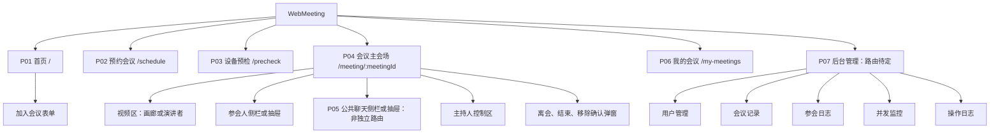
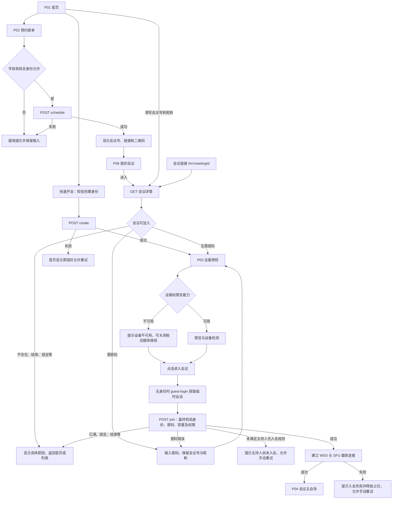
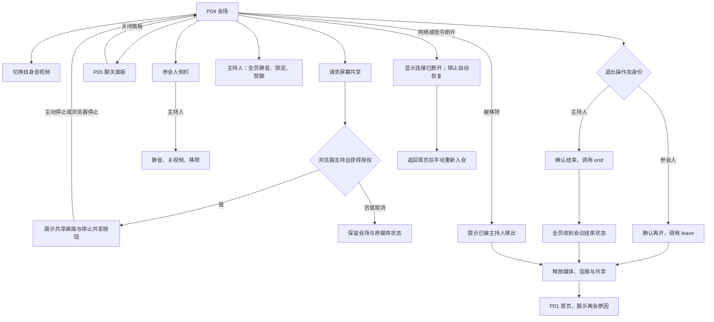

Web 视频会议系统（对标腾讯会议 Web 版）完整版 PRD
文档版本：V1.0（MVP 一期）
架构：WebRTC+SFU+WebSocket 信令；前端 Vue3；后端 Node.js/Java；存储 OSS；内网穿透 STUN/TURN 服务
包含：产品需求、页面原型说明、数据库字段、REST 接口清单、WebSocket 信令协议、全套 AI 开发提示词。
一、项目总览
1.1 项目名称
云会议 Web 端（WebMeeting）
1.2 产品定位
纯浏览器音视频会议，无需安装客户端，支持 PC + 移动端浏览器访问；支持游客免登录入会，对标腾讯会议 Web 端基础能力；一期只做核心会议能力，二期迭代互动功能。
1.3 用户角色
主持人（创建者）：会议全权管控
参会人：入会、音视频、举手、聊天
游客：免登录，仅会议号 + 昵称入会
平台管理员：后台运维、数据统计
1.4 版本规划
MVP 一期（本期开发）：创建 / 加入会议、音视频、屏幕共享、文字聊天、主持人管控、设备预检
二期：等候室、举手、录制、白板、字幕、联席主持人、断线重连
二、产品原型 & 页面详细说明（Axure/Figma 页面清单）
页面 1：首页（根页面 /）
页面布局
上半部分两大按钮：【快速开会】【预约会议】；下半部分【加入会议】表单；底部个人历史会议入口。
字段与交互
快速开会：点击立即生成随机会议号，自动跳转设备预检页
预约会议：弹出表单（见页面 2）
加入会议表单：
会议号（必填，数字 + 字母）
昵称（必填）
会议密码（选填，密码会议才显示）
入会选项：【关闭摄像头】【静音入会】复选框
跳转按钮：点击【加入会议】→设备预检页
页面 2：预约会议页面（/schedule）
表单字段（数据库字段完全对应）
表格
字段名	类型	必填	默认值	说明
meeting_title	字符串	是	无	会议主题
start_time	时间戳	是	无	会议开始时间
duration	数字	否	60	会议时长（分钟）
meeting_password	字符串	否	空	入会密码，6 位数字
max_participants	数字	否	25	最大参会人数
open_waiting_room	布尔	否	false	是否开启等候室（一期先隐藏，二期启用）
join_before_host	布尔	否	true	参会人能否在主持人之前入会
default_mute	布尔	否	true	全员入会自动静音
交互
提交后生成唯一会议号、会议链接、二维码；存入数据库，进入【我的会议】列表。
页面 3：入会设备预检页（/precheck）
核心模块
麦克风检测：收音波形、测试扬声器
摄像头预览：画面实时预览，可切换摄像头设备
设备选择下拉框：切换麦克风 / 摄像头 / 扬声器
两个按钮：【关闭视频】【静音】；【进入会议】
前置校验
浏览器权限：申请摄像头 + 麦克风权限；无权限则弹窗提示。
页面 4：会议主会场（核心页面 /meeting/:meetingId）
整体布局（对标腾讯会议 Web 端）
顶部栏：会议号、会议主题、退出按钮
左侧：参会人列表侧边栏（可收起）
中间主区域：视频画布（画廊模式 / 演讲者模式切换）
底部工具栏（固定）：开启 / 关闭摄像头、麦克风、共享屏幕、聊天、参会人、退出会议
右侧：聊天面板（可收起）
视频布局规则
画廊模式：等分多格，自动排布所有参会视频流
演讲者模式：主讲人大屏，其余参会人缩为小窗；自动识别正在发言的人（语音激励）
参会人列表字段
用户 ID、昵称、头像、麦克风状态、摄像头状态、是否主讲、举手状态；主持人可看到全员操作按钮（静音、移除、关闭视频）。
页面 5：聊天侧边栏
公共聊天：全员文字消息，展示发送人 + 时间 + 内容
输入框：仅支持纯文本；主持人可一键关闭全员聊天
消息实时推送，历史消息加载
页面 6：个人中心 - 我的会议（/my-meetings）
列表字段：会议号、主题、开始时间、参会人数、会议状态（未开始 / 进行中 / 已结束）、操作（进入会议、取消会议）。
页面 7：后台管理页面（管理员）
用户管理、会议记录、参会日志、并发监控、操作日志。
三、数据库设计（MySQL 表结构 + 完整字段）
表 1：用户表 user
sql
CREATE TABLE `user` (
  id bigint PRIMARY KEY AUTO_INCREMENT COMMENT '用户ID',
  username varchar(50) COMMENT '账号',
  nickname varchar(50) NOT NULL COMMENT '昵称',
  avatar varchar(255) COMMENT '头像地址',
  phone varchar(11) UNIQUE COMMENT '手机号',
  password varchar(100) COMMENT '密码（MD5加密）',
  is_guest tinyint DEFAULT 0 COMMENT '0注册用户，1游客临时账号',
  created_at datetime DEFAULT CURRENT_TIMESTAMP,
  updated_at datetime DEFAULT CURRENT_TIMESTAMP ON UPDATE CURRENT_TIMESTAMP
) ENGINE=InnoDB DEFAULT CHARSET=utf8mb4;
表 2：会议主表 meeting（核心）
sql
CREATE TABLE `meeting` (
  id bigint PRIMARY KEY AUTO_INCREMENT,
  meeting_id varchar(32) NOT NULL UNIQUE COMMENT '唯一会议号（对外展示）',
  title varchar(100) NOT NULL COMMENT '会议主题',
  host_id bigint NOT NULL COMMENT '主持人用户ID',
  meeting_password varchar(10) DEFAULT '' COMMENT '入会密码',
  start_time bigint COMMENT '开始时间戳',
  duration int DEFAULT 60 COMMENT '时长（分钟）',
  max_participants int DEFAULT 25 COMMENT '最大人数',
  open_waiting_room tinyint DEFAULT 0 COMMENT '等候室开关',
  join_before_host tinyint DEFAULT 1 COMMENT '是否允许先入会',
  default_mute tinyint DEFAULT 1 COMMENT '入会自动静音',
  meeting_status tinyint DEFAULT 0 COMMENT '0未开始 1进行中 2已结束',
  created_at datetime DEFAULT CURRENT_TIMESTAMP,
  ended_at datetime NULL,
  INDEX idx_meeting_id(meeting_id),
  INDEX idx_host(host_id)
) ENGINE=InnoDB DEFAULT CHARSET=utf8mb4;
表 3：参会记录表 meeting_participant
sql
CREATE TABLE `meeting_participant` (
  id bigint PRIMARY KEY AUTO_INCREMENT,
  meeting_id varchar(32) NOT NULL COMMENT '会议号',
  user_id bigint NOT NULL COMMENT '参会人ID，游客为临时ID',
  nickname varchar(50) NOT NULL COMMENT '入会昵称',
  join_time datetime NOT NULL COMMENT '入会时间',
  leave_time datetime NULL COMMENT '离会时间',
  is_host tinyint DEFAULT 0 COMMENT '是否主持人',
  audio_status tinyint DEFAULT 1 COMMENT '0静音 1开启',
  video_status tinyint DEFAULT 1 COMMENT '0关闭 1开启',
  screen_share tinyint DEFAULT 0 COMMENT '是否正在共享屏幕',
  INDEX idx_meeting(meeting_id)
) ENGINE=InnoDB DEFAULT CHARSET=utf8mb4;
表 4：会议聊天记录表 meeting_chat
sql
CREATE TABLE `meeting_chat` (
  id bigint PRIMARY KEY AUTO_INCREMENT,
  meeting_id varchar(32) NOT NULL,
  sender_id bigint NOT NULL,
  sender_name varchar(50) NOT NULL,
  content text NOT NULL COMMENT '聊天文本',
  send_time datetime DEFAULT CURRENT_TIMESTAMP,
  INDEX idx_meeting(meeting_id)
) ENGINE=InnoDB DEFAULT CHARSET=utf8mb4;
四、后端 REST 接口清单（HTTP+JSON，一期全部接口）
4.1 用户模块
游客临时登录（免注册）
POST /api/user/guest-login
请求体：{nickname: string}
返回：{userId, token, isGuest:true}
账号登录（手机号 + 密码）
POST /api/user/login
4.2 会议创建 & 预约模块
创建即时会议（快速开会）
POST /api/meetings/create
请求体：
json
{
  "title": "临时会议",
  "hostId": 123,
  "meetingPassword": "",
  "maxParticipants": 25,
  "defaultMute": true
}
返回：
json
{
  "code": 0,
  "data": {
    "meetingId": "MTG-987654",
    "joinUrl": "https://xxx.com/m/MTG-987654",
    "token": "jwt会话令牌",
    "meetingInfo": {}
  }
}
预约会议
POST /api/meetings/schedule
入参同预约页面全部字段
获取会议详情（入会校验）
GET /api/meetings/{meetingId}
返回会议基础信息、入会权限
加入会议（校验密码 + 人数上限）
POST /api/meetings/{meetingId}/join
请求体：{nickname, password, userId}
返回：入会凭证 + WebSocket 信令地址 + SFU 服务地址
离开会议
POST /api/meetings/{meetingId}/leave
结束会议（主持人）
PUT /api/meetings/{meetingId}/end
4.3 参会人管理接口
获取当前在线参会列表
GET /api/meetings/{meetingId}/participants
主持人静音 / 取消静音参会人
PUT /api/meetings/{meetingId}/participant/mute
{targetUserId, media:"audio|video", mute:true/false}
移除参会人
DELETE /api/meetings/{meetingId}/participant/{userId}
锁定会议
PUT /api/meetings/{meetingId}/lock
4.4 聊天接口
POST /api/meetings/{meetingId}/chat/send
{content: string}
4.5 会中状态同步（全部走 WebSocket，REST 只做业务操作）
五、WebSocket 实时信令协议（wss://domain/ws/signaling/{meetingId}）
所有音视频信令、会议控制指令全部走 WebSocket，JSON 格式，type 区分消息类型
5.1 基础消息结构
json
{
  "type": "消息类型",
  "from": "当前用户ID",
  "target": "目标用户ID，全员广播填all",
  "payload": {}
}
5.2 消息类型清单（一期必实现）
音视频 SDP 交换
offer：发起视频流
answer：应答视频流
ice_candidate：内网穿透 ICE 候选信息
参会人上下线事件
participant_joined：新成员入会
participant_left：成员离会
媒体状态控制
toggle_audio：麦克风开关
toggle_video：摄像头开关
screen_share_start：开启屏幕共享
screen_share_stop：停止共享
主持人控制指令
host_mute_all：全员静音
kick_user：踢出参会人
close_chat：关闭全员聊天
语音激励事件
active_speaker：推送当前发言用户 ID，前端自动切换主讲画面
布局切换
switch_layout：gallery（画廊）/speaker（演讲者）
六、非功能 & 安全需求
浏览器兼容：Chrome、Edge、Safari；移动端优先兼容手机 Safari、Chrome；微信内置浏览器限制较多，做降级提示
弱网策略：自动降低视频分辨率、码率；网络差自动提示关闭视频
安全：信令 wss 加密；WebRTC 原生 SRTP 加密；会议号 + 密码双重校验；会议结束后会议号失效；游客仅临时会话，无持久账号
性能：单会议支持 25 人同时在线；端到端音视频时延＜300ms；断线自动重连 WebSocket 与音视频流

---

# 七、MVP 一期交付补充规范

```json
{
  "document": "Web 视频会议系统 PRD",
  "version": "V1.0-MVP-补充版",
  "source": "用户提供的 V1.0 PRD，第一至六章保留原文",
  "priority": "第七至十三章用于指出原文冲突及落实交付；待确认项不视为已批准需求",
  "reference": "腾讯会议 Web 版基础体验，仅作信息组织与交互参考",
  "deliverables": ["Figma页面结构", "页面跳转流程", "产品用例", "Axure字段标注", "产品验收标准"],
  "figma_delivery_type": "可用于搭建Figma页面及连接原型的文本规范，非已创建的Figma源文件",
  "in_scope": ["快速开会", "预约会议", "会议号或链接入会", "游客临时身份", "设备预检", "音视频", "屏幕共享", "公共文字聊天", "主持人管控", "我的会议"],
  "existing_scope_needs_confirmation": ["账号登录入口及会话约定", "后台管理五个模块的交付深度"],
  "out_of_scope": ["等候室", "举手", "录制", "白板", "字幕", "联席主持人", "断线自动重连"],
  "rule": "未由原文明确规定的阈值、状态或接口，均标为建议或待确认，不擅自视为开发基线"
}
```

## 7.1 范围冲突与裁决

| 编号 | 原文问题 | 本文处理 | 对交付的影响 |
|---|---|---|---|
| S01 | 角色、参会列表出现举手，一期规划未包含 | 删除一期举手入口、字段展示、事件和验收项 | 不开发举手 |
| S02 | 预约表及数据库保留 open_waiting_room | 一期页面不显示；服务端有效值固定为 false，不得通过请求启用 | 不创建等候室页面、队列或审批流程 |
| S03 | 二期含断线重连，非功能章要求自动重连 | 一期按版本规划排除自动重连；仅断线提示、资源清理及用户主动重新入会 | 不验收自动恢复；上线文案不得宣称自动重连 |
| S04 | 锁定会议、全员静音、关闭视频、禁用聊天分散在接口或信令中 | 归入已有主持人管控；锁定是拒绝新成员入会，不能转入等候室 | 纳入一期 |
| S05 | 第七页后台和账号登录有名称，缺页面字段、鉴权规则及接口 | 保留页面结构和最小用例；具体交付深度列为待确认 | 不擅自增加注册、找回密码、用户封禁、报表导出等功能 |
| S06 | 首页预约为弹窗，又定义 /schedule 页面 | 建议统一以 /schedule 为预约主页面；首页点击跳转；如采用弹窗须复用同一表单 | 该导航方案为本文建议，设计评审确认 |
| S07 | 个人历史会议与“我的会议”混用 | 建议一期列表仅显示当前身份创建的会议；不扩展参会历史 | 列表所有权及游客会话丢失后的可见性待确认 |
| S08 | 有取消操作，但状态枚举只有未开始、进行中、已结束 | 取消仅允许创建者对未开始会议操作；取消状态映射及接口待确认 | 不将本地删除当作取消成功 |
| S09 | 主持人取消静音接口可能直接开启他人麦克风 | 主持人可关闭他人媒体；取消静音不得绕过浏览器权限或用户操作 | 建议一期不展示远程开启他人媒体按钮；是否提示自行开启待确认 |
| S10 | 会议密码在入会时才显示，但缺预校验信息 | 详情需返回是否需要密码，不能返回明文密码 | 接口补全后验收入会链路 |

## 7.2 权限矩阵

| 能力 | 游客参会人 | 登录参会人 | 主持人/创建者 | 平台管理员 |
|---|---|---|---|---|
| 输入会议号/链接入会、设备预检 | 是 | 是 | 是 | 作为参会身份时同参会人 |
| 自身音视频、布局、聊天、共享、离会 | 是 | 是 | 是 | 不因后台身份自动获得会内控制权 |
| 创建/预约及查看我的会议 | 游客是否可创建待确认 | 是 | 是 | 同普通登录身份 |
| 取消未开始的本人会议 | 否，除非确认游客创建权限 | 仅本人创建的会议 | 是 | 不默认提供代取消 |
| 全员静音、单人静音/关视频、移除、锁定、禁聊、结束 | 否 | 否 | 是 | 仅在同时为主持人时 |
| 后台管理页面 | 否 | 否 | 否 | 是，具体读写范围待确认 |

> 昵称不能作为授权依据。所有会内权限由服务端令牌、会议归属和成员会话校验；hostId、userId、from 等客户端字段不能自行赋权。

# 八、Figma 页面结构图与页面跳转流程

## 8.1 Figma 文件组织

```json
{
  "figma_pages": [
    {"name": "00_范围与规范", "frames": ["一期范围", "角色权限", "页面索引", "待确认项"]},
    {"name": "01_组件", "frames": ["导航", "按钮与表单", "设备选择器", "视频格", "参会人行", "聊天消息", "确认弹窗", "错误与空状态"]},
    {"name": "02_PC主流程", "frames": ["P01首页", "P02预约会议", "P03设备预检", "P04会议主会场", "P05公共聊天面板", "P06我的会议"]},
    {"name": "03_PC状态与弹窗", "frames": ["密码校验", "设备权限受限", "会议已满", "会议锁定", "会议已结束", "离会确认", "结束会议确认", "移除确认", "共享冲突", "网络断开", "预约成功"]},
    {"name": "04_移动端", "frames": ["首页", "预约", "预检", "会场", "参会人抽屉", "聊天抽屉", "我的会议", "能力不支持提示"]},
    {"name": "05_后台待确认", "frames": ["P07后台外壳", "用户管理", "会议记录", "参会日志", "并发监控", "操作日志"]}
  ],
  "naming": "页面ID/角色/状态/终端",
  "example": "P04/主持人/屏幕共享中/PC",
  "annotation": ["控件ID", "字段映射", "显示条件", "操作", "接口或事件", "成功反馈", "失败反馈", "验收编号"],
  "responsive_rule": "移动端保留可用的核心会议操作，侧栏采用抽屉；屏幕共享发起与扬声器切换按浏览器实际能力降级"
}
```

## 8.2 页面结构图



## 8.3 入口与入会流程



> 图中密码在 join 最终校验；详情页不能判断密码正确。快速开会已有身份时复用该身份。创建者首次入会可使用创建返回凭证，是否仍需调用 join 由接口契约统一，不能重复计数。

## 8.4 会中与离会流程



> 因一期没有联席主持人和主持人转移，建议主持人仅提供“结束会议”；“主持人只离开而会议继续”的行为待确认，不默认开发。接口失败时不得提前宣布取消、移除或结束成功。

# 九、完整产品用例

## 9.1 通用规则

- 用例中的待确认规则仅用于评审，未确认前不得以实现任选一种方式作为验收通过。
- 所有业务写操作防重复提交；失败保留可重试输入；以服务端结果为准更新共享状态。
- 预检只建立本地设备预览，不增加在线人数，也不向其他成员发布媒体。
- 手动重新入会必须重新执行有效性、容量、权限校验；不是自动重连。

## 9.2 用例清单

| ID | 角色与目标 | 前置条件 | 主流程 | 分支与异常 | 后置条件 |
|---|---|---|---|---|---|
| UC01 | 创建者快速开会 | 创建身份有效；游客权限按 C01 | 首页点击快速开会→create→取得会议号与凭证→预检→入会 | 无权限提示登录；创建失败原页重试；重复点击不重复创建 | 唯一会议记录；仅入会成功后计为在线 |
| UC02 | 创建者预约会议 | 具有创建权限 | 进入预约页→填写与校验→schedule→展示会议号/链接/二维码→我的会议 | 字段错误就地提示；失败保留输入；重复提交抑制 | 会议初始状态未开始，创建者可见 |
| UC03 | 参会人凭会议号入会 | 有效会议号、昵称 | 查询详情→按需输入密码→设备预检→临时身份→join→信令与媒体连接→进入会场 | 会议不存在/结束/锁定/已满、密码错误、令牌失效分别提示；失败释放资源 | 获得本会议成员身份及在线记录 |
| UC04 | 参会人凭链接或二维码入会 | 可解析会议链接 | 打开 /m/:meetingId→带入会议号→填写昵称→复用 UC03 | 链接无效显示“会议链接无效”；二维码只编码入会链接，不包含令牌或密码 | 与会议号入会的校验一致 |
| UC05 | 用户完成设备预检 | 已确定目标会议 | 申请所需权限→预览→选择设备→测试扬声器→设置开关→进入 | 拒绝/无设备/设备占用/不支持时明确提示；允许关闭对应媒体继续；取消离开停止采集 | 入会使用最终可用设备状态 |
| UC06 | 参会人控制自身音视频 | 已在会中 | 切换麦克风或摄像头→媒体生效→同步状态→其他成员更新 | 无权限时保留关闭；设备拔出提示；发送失败不显示虚假开启状态 | UI、实际发送轨道与成员状态一致 |
| UC07 | 参会人切换视频布局 | 已在会中 | 选择画廊/演讲者→重新排布；演讲者视图响应 active_speaker | 无视频用昵称/头像占位；共享时布局优先级按 C05 | 不改变他人的布局；本地选择保留至离会 |
| UC08 | 参会人屏幕共享 | 浏览器支持；已入会 | 点击共享→系统选择器授权→发布共享流→全员观看→停止共享 | 取消选择不报业务成功；不支持明确降级；并发共享策略按 C05；浏览器停止触发清理 | 停止后共享轨道与标记清除，恢复会场布局 |
| UC09 | 成员查看参会人 | 已入会 | 打开侧栏→加载在线快照→通过事件增减成员、更新媒体状态 | 加载失败显示重试；乱序/重复事件不重复计数 | 在线列表、人数、会场一致 |
| UC10 | 主持人静音或关视频 | 主持人在线；目标仍在会中 | 对目标操作→服务端鉴权→停止目标上行或取消订阅发布→同步状态 | 非主持人拒绝；目标离开提示；不远程强开麦克风/摄像头 | 目标真实停止发送相应媒体 |
| UC11 | 主持人全员静音 | 主持人在线 | 点击全员静音→控制生效→受影响成员状态同步 | 建议作用于当前其他成员，主持人及后续入会是否受影响按 C04 | 静音范围符合确认规则；不修改预约默认值 |
| UC12 | 主持人移除成员 | 目标在线且不是自己 | 点击移除→确认→DELETE→目标退出→全员列表更新 | 取消确认无副作用；失败保留目标；被移除后能否再次加入按 C06 | 目标媒体与成员凭证失效，人数释放 |
| UC13 | 主持人锁定/解锁 | 主持人在线 | 切换锁定→接口成功→同步状态→后续 join 按锁定状态处理 | 非主持人拒绝；失败恢复原状态；与 join 并发以服务端事务结果为准 | 原在线成员保留，新成员按有效规则处理 |
| UC14 | 成员发送与查看公共聊天 | 已入会且聊天开放 | 打开面板→加载历史→输入纯文本→send→成功展示→全员接收 | 空内容拦截；超长规则待确认；发送失败可重试；HTTP/WS重复消息去重 | 消息按服务端时间/序号稳定显示，不执行 HTML |
| UC15 | 主持人关闭/恢复聊天 | 主持人在线 | 切换聊天开关→服务端确认→广播→更新输入区 | 非主持人拒绝；关闭后发送接口也拒绝；主持人是否豁免按 C07 | 旧消息仍可查看，新消息按权限处理 |
| UC16 | 参会人主动离会 | 普通成员已入会 | 点击离开→确认→leave→释放资源→首页提示 | 取消仍在会中；网络不可达时本地释放资源，服务器会话超时清理，不无限阻止用户离开 | 不再在线、不再采集或共享 |
| UC17 | 主持人结束会议 | 主持人已入会 | 点击结束→确认→end→广播→全员退出 | 取消无变化；请求失败不显示已结束；重复结束幂等 | 状态已结束、ended_at有效、会议号不能再入会 |
| UC18 | 创建者查看我的会议 | 身份有效 | 打开列表→读取本人会议→显示状态→选择可进入会议 | 空列表给出创建入口；失败可重试；其他人会议不可见 | 列表以服务端持久化结果为准 |
| UC19 | 创建者取消预约 | 本人创建且未开始 | 点击取消→确认→取消接口→列表及入会能力同步 | 已开始则拒绝；非本人拒绝；取消接口缺失，见 G02 | 预约不可再加入；取消状态映射待确认 |
| UC20 | 用户处理连接失败 | 入会中或会中发生断线 | 显示断线状态→停止无效采集/共享→返回入口→用户手动重新入会 | 不自动重试连接；会话清理时限按 C09；重新入会仍受锁定/容量/密码约束 | 无残留在线占位或重复成员 |
| UC21 | 平台管理员访问后台 | 后台身份已验证 | 打开 P07→切换用户、会议、参会日志、并发、操作日志模块→查看结果 | 未授权返回无权限；无数据/加载失败有明确状态 | 仅访问授权数据；字段、筛选、分页和刷新规则待确认 |
| UC22 | 登录用户取得会话 | 已有账号；登录入口按 C01 | 输入手机号与密码→login→取得有效会话→返回原业务入口 | 账号/密码错误统一提示；失败不进入受保护操作；会话过期重新验证 | 不新增注册、短信验证或找回密码 |

## 9.3 状态与业务约束

| 对象 | 状态与转换 | 明确约束 |
|---|---|---|
| 会议 | 未开始→进行中→已结束 | 何时从未开始变为进行中按 C03；已结束不可逆 |
| 预约取消 | 未开始→取消后终态 | 原枚举无取消态，必须先确认映射；不可静默删除数据库记录 |
| 成员 | 未加入→加入校验→连接中→在线→离开/移除/会议结束 | 每次成功入会生成可识别的成员会话；同身份多标签策略按 C06 |
| 自身媒体 | 关闭→申请权限→开启；开启→关闭/设备故障 | 浏览器权限、实际轨道和服务端允许状态共同决定可用性 |
| 屏幕共享 | 未共享→系统授权→共享中→停止 | 用户取消授权回到未共享，不能清除正常音视频 |
| 聊天 | 开放↔关闭 | 关闭为发送权限变化，已存在的消息不清除 |
| 断线 | 正常→连接断开→用户手动返回/重新入会 | 不包含二期自动重连及原状态自动恢复 |

# 十、Axure 原型字段与交互标注文案

## 10.1 标注模板

```json
{
  "widget_id": "Pxx-字段或动作",
  "label": "界面文字",
  "binding": "前端字段 → REST字段或WebSocket payload",
  "type": "数据类型及控件类型",
  "required": "必填条件",
  "default": "默认值或数据来源",
  "validation": "校验规则；未定义阈值标记待确认",
  "visibility": "角色与状态条件",
  "interaction": "触发动作与请求时机",
  "success": "成功反馈",
  "error": "逐项错误文案",
  "acceptance_ids": ["AC编号"]
}
```

## 10.2 P01 首页与入会字段

| 控件ID | 界面文案 / 数据绑定 | 类型、必填与默认值 | 校验与交互标注 |
|---|---|---|---|
| P01-01 | 快速开会 / create | 按钮 | 具有创建身份才提交；加载中禁用重复点击；成功进入预检；失败：“创建会议失败，请重试” |
| P01-02 | 预约会议 | 按钮 | 跳转 /schedule；身份缺失按确认后的登录路径处理 |
| P01-03 | 会议号 / meetingId→路径参数 | 文本，必填，无默认 | 提示“请输入会议号”；原例 MTG-987654 含连字符，必须接受系统真实生成格式；去首尾空格，大小写及精确规则待确认；不得只允许数字 |
| P01-04 | 昵称 / nickname→guest-login、join | 文本，必填 | 去首尾空白，空值：“请输入昵称”；最大长度建议与数据库50字符一致，计数方式待确认；重复昵称不等于同一用户 |
| P01-05 | 会议密码 / password→join.password | 密码输入，条件必填 | 详情标记需密码才显示；6位数字，前导0保留；“请输入6位数字会议密码”“会议密码错误，请重新输入”；不写入URL或日志 |
| P01-06 | 关闭摄像头 / 本地入会偏好 | 复选框，默认待确认 | 勾选后预检不主动打开摄像头；带到会场 |
| P01-07 | 静音入会 / 本地入会偏好 | 复选框，默认待确认 | 若会议 default_mute=true，入会必须静音；建议规则为个人静音或会议默认静音任一开启即静音 |
| P01-08 | 加入会议 | 按钮 | 必填校验后获取详情进入预检；最终入会权限以join为准；详情请求期间禁止重复提交 |
| P01-09 | 我的会议 | 链接 | 跳转 /my-meetings；无有效身份按确认方案处理 |

## 10.3 P02 预约字段

> 页面字段沿用原文 snake_case；接口已有 create 使用 camelCase。schedule 必须给出明确DTO映射，不允许前后端自行推断混用。

| 控件ID / 数据字段 | 界面文案 | 类型 / 必填 / 默认 | Axure校验、反馈与映射 |
|---|---|---|---|
| P02-01 meeting_title→meeting.title | 会议主题 | 文本 / 是 / 空 | “请输入会议主题”；去首尾空白；数据库上限100字符，建议界面一致，计数方式待确认 |
| P02-02 start_time | 开始时间 | 日期时间 / 是 / 空 | “请选择开始时间”；时间戳秒或毫秒必须统一；按用户本地时区显示；是否允许过去时间、提前多久入会见 C03 |
| P02-03 duration | 会议时长（分钟） | 整数 / 否 / 60 | 正整数；“请输入有效的会议时长”；上下限及到期是否自动结束待确认，不默认实现自动结束 |
| P02-04 meeting_password | 会议密码（选填） | 密码文本 / 否 / 空 | 留空不设密码；非空仅6位数字；“会议密码须为6位数字”；不能转数值 |
| P02-05 max_participants | 最大参会人数 | 整数 / 否 / 25 | 建议1～25且包含主持人；“请输入1～25之间的整数”；范围和计数口径待 C04 确认 |
| P02-06 join_before_host | 允许成员在主持人之前入会 | 开关 / 否 / true | false且主持人未在线，join拒绝并提示“主持人尚未入会，请稍后重试”；无等待队列 |
| P02-07 default_mute | 成员入会时自动静音 | 开关 / 否 / true | 作用于初始入会状态；是否允许成员会中自行开麦按 C04 |
| P02-08 open_waiting_room | 一期不展示 | 内部布尔 / 否 / false | 不输出用户可操作控件，服务端不接受启用值；不加入一期原型页面 |
| P02-09 | 创建预约 | 按钮 | 校验成功发schedule；加载中禁用；失败保留填写；成功显示会议号、链接、二维码并提供“查看我的会议” |
| P02-10 meetingId/joinUrl/QR | 会议号 / 复制链接 / 入会二维码 | 只读 | 使用服务端返回结果；复制成功：“会议链接已复制”；失败：“复制失败，请手动复制”；二维码只编码入会URL |

## 10.4 P03 设备预检

| 控件ID | 文案 / 绑定 | 标注 |
|---|---|---|
| P03-01 | 麦克风 / 本地deviceId | 下拉列出可用输入；无权限时显示“请允许浏览器使用麦克风”；切换失败：“麦克风切换失败，请重新选择” |
| P03-02 | 摄像头 / 本地deviceId | 下拉列出可用视频输入；预览仅本地可见；切换成功停止旧轨道；无设备：“未检测到摄像头” |
| P03-03 | 扬声器 / 本地deviceId | 浏览器支持输出设备选择时展示；不支持显示“请使用系统设置切换扬声器”；不伪造切换成功 |
| P03-04 | 测试扬声器 | 用户点击后播放测试音；播放失败：“无法播放测试音，请检查系统声音设置” |
| P03-05 | 麦克风音量 | 实时本地收音反馈；静音时明确显示“麦克风已静音”；不要求上传测试音 |
| P03-06 | 开启/关闭摄像头；取消静音/静音 | 根据真实状态切换文案；拒绝权限保留关闭态；支持无媒体入会 |
| P03-07 | 进入会议 | join成功后建立连接，入会中禁用重复点击；容量等校验失败显示服务端对应原因 |
| P03-08 | 返回 | 返回入口，停止预览采集；不调用leave，因为尚未占用在线名额 |

## 10.5 P04 主会场与参会人

| 控件ID / 字段 | 文案与展示 | 交互及权限标注 |
|---|---|---|
| P04-01 meetingId/title | 会议号、会议主题 | 只读，来自服务端；长主题截断并可查看完整内容；不显示密码 |
| P04-02 userId/nickname/avatar | 参会人头像、昵称 | userId为内部标识；不要求对普通用户裸露ID；无头像显示昵称占位；主持人附身份标记 |
| P04-03 audio_status/video_status | 麦克风/摄像头状态 | 0=静音或关闭，1=开启；以实际发布状态更新，不能直接采用数据库默认1覆盖入会静音 |
| P04-04 active_speaker | 当前发言人 | 响应语音激励；“正在发言”仅表示当前发言，不新增“主讲人”角色授权 |
| P04-05 layout | 画廊 / 演讲者 | 当前用户本地视图状态；若沿用switch_layout事件，不可强制改变其他成员视图 |
| P04-06 | 共享屏幕 / 停止共享 | 支持时可用；不支持：“当前浏览器不支持发起屏幕共享”；取消系统选择器保留原状态 |
| P04-07 | 参会人（在线人数） | 打开/收起侧栏；人数包含主持人建议见 C04；不统计预检用户和已离线用户 |
| P04-08 | 静音 / 关闭视频 | 仅主持人对其他在线成员显示；调用mute并确认结果；不提供无授权远程开启 |
| P04-09 | 全员静音 | 仅主持人；生效范围按 C04；成功反馈“已将其他成员静音”须与最终规则一致 |
| P04-10 | 移除 | 仅主持人；确认：“确定将「昵称」移出会议吗？”；按钮“取消”“移除”；成功后目标离会 |
| P04-11 locked | 锁定会议 / 解除锁定 | 仅主持人；状态来自服务端；锁定后提示“会议已锁定，新成员暂时无法加入” |
| P04-12 | 离开会议 | 普通成员；确认：“确定离开当前会议吗？”；按钮“取消”“离开会议” |
| P04-13 | 结束会议 | 主持人；确认：“结束后所有成员将离开，且无法再次加入此会议。”；按钮“取消”“结束会议” |
| P04-14 | 连接已断开 | “连接已断开，请返回后重新加入会议”；提供“返回首页”；不显示自动重连倒计时 |

## 10.6 P05 聊天面板

| 控件ID / 字段 | 文案与规则 | 交互标注 |
|---|---|---|
| P05-01 id/sender_id/sender_name/send_time/content | 消息ID内部使用；展示发送人、时间、纯文本 | 服务端返回唯一ID；以文本转义渲染；历史分页游标及可见范围待 C07；不扩展私聊、图片、文件、表情面板 |
| P05-02 content | “输入消息” | 空白内容不可发，提示“请输入消息”；文本上限待 C07，未确认前不得写死任意数值 |
| P05-03 | 发送 | 发送中有明确状态；失败显示“发送失败，请重试”；成功由服务端消息ID去重；重试幂等约定见 G05 |
| P05-04 chatEnabled | 关闭全员聊天 / 恢复聊天 | 仅主持人显示；关闭后受限成员输入区禁用，提示“主持人已关闭全员聊天”；历史仍可读 |
| P05-05 | 暂无消息 / 历史消息加载失败，请重试 | 空态和失败态分开；关闭面板不删除消息、不退出会议 |

## 10.7 P06 我的会议

| 控件ID / 字段 | 文案与规则 | 标注 |
|---|---|---|
| P06-01 meeting_id/title/start_time | 会议号 / 主题 / 开始时间 | 只读，时间按本地时区格式化；空值展示规则待确认 |
| P06-02 participant_count | 参会人数 | 原表无该聚合字段；必须确认是当前在线、累计唯一成员或累计入会次数，不能混用 |
| P06-03 meeting_status | 未开始 / 进行中 / 已结束 | 对应0/1/2；取消展示等待状态契约补全 |
| P06-04 | 进入会议 | 对可加入会议显示；先获取最新详情并走预检；已结束禁用或隐藏 |
| P06-05 | 取消会议 | 仅本人未开始会议；确认：“确定取消此预约会议吗？取消后成员将无法加入。”；提交成功后更新列表 |
| P06-06 | 暂无会议 / 加载失败，请重试 | 空态提供预约入口；异常不展示为“暂无会议” |

## 10.8 P07 后台与现有登录接口的待补标注

| 模块 | 原文可确认的展示目的 | 必须补齐后才能标注的内容 |
|---|---|---|
| 用户管理 | 查看平台用户信息 | 列字段、敏感信息脱敏、可执行操作、筛选及接口；不默认增加增删改封禁 |
| 会议记录 | 查看会议记录 | 会议记录字段、时间口径、查询范围及分页接口 |
| 参会日志 | 查看加入和离开记录 | 成员会话标识、离会原因、时间字段、查询接口 |
| 并发监控 | 查看并发情况 | 在线人数/房间/媒体连接口径、刷新频率、数据接口 |
| 操作日志 | 查看操作审计记录 | 操作者、操作、对象、时间、结果字段及查询接口 |
| 账号登录 | 手机号与密码登录 | 入口/返回路径、字段名、会话响应、失效处理；密码不可回显或记录 |

# 十一、字段、接口与信令闭环检查

## 11.1 现有接口映射

| 页面/用例 | 已有REST接口 | 已有信令 | 缺口或边界 |
|---|---|---|---|
| P01/UC01 | POST /api/meetings/create | 无 | 创建身份权限、会话令牌用途、幂等约定 |
| P02/UC02 | POST /api/meetings/schedule | 无 | snake_case/camelCase映射及成功响应 |
| UC03/04 | GET /api/meetings/{meetingId}；POST /api/user/guest-login；POST /api/meetings/{meetingId}/join | offer、answer、ice_candidate | 密码标记、受限信息披露、入会凭证期限、连接失败释放占位 |
| UC06/07 | GET participants | toggle_audio、toggle_video、active_speaker、switch_layout | 媒体状态服务端确认，布局保持本地语义 |
| UC08 | 原文无独立REST要求 | screen_share_start、screen_share_stop | 共享并发策略及所有权 |
| UC09 | GET /api/meetings/{meetingId}/participants | participant_joined、participant_left | 成员唯一会话、快照与事件顺序 |
| UC10/11 | PUT /api/meetings/{meetingId}/participant/mute | host_mute_all、toggle_audio、toggle_video | 全员控制请求与结果的区分；成员自行开麦规则 |
| UC12 | DELETE /api/meetings/{meetingId}/participant/{userId} | kick_user、participant_left | 移除原因、再入会策略、目标成员会话 |
| UC13 | PUT /api/meetings/{meetingId}/lock | 缺状态广播定义 | 解锁请求字段及新加入成员快照 |
| UC14/15 | POST /api/meetings/{meetingId}/chat/send | close_chat | 历史查询、消息广播、恢复聊天与chatEnabled快照 |
| UC16/17 | POST leave；PUT end | participant_left | 会议结束广播及原因 |
| UC18/19 | 原文缺列表与取消接口 | 无 | 我的会议读写链路不闭合 |
| UC21/22 | POST /api/user/login；后台接口缺失 | 无 | 登录契约和后台数据契约 |

## 11.2 为既有一期功能补齐的契约建议

> 以下均为待评审的契约建议，不是已存在或已批准的接口；用途仅为补全原文已有功能，不增加新功能。

```json
{
  "status": "待接口评审确认",
  "gaps": [
    {"id": "G01", "capability": "我的会议列表", "suggestion": "GET /api/meetings/mine", "minimum_response": ["meetingId", "title", "startTime", "participantCount", "meetingStatus", "可操作权限"], "open_points": ["分页", "排序", "人数口径", "取消状态"]},
    {"id": "G02", "capability": "取消未开始预约", "suggestion": "PUT /api/meetings/{meetingId}/cancel", "rules": ["仅创建者", "仅未开始", "幂等", "取消后join拒绝"], "open_points": ["状态码映射", "与入会并发的原子性"]},
    {"id": "G03", "capability": "公共聊天历史", "suggestion": "GET /api/meetings/{meetingId}/chat/history", "open_points": ["分页游标", "每页条数", "入会前历史可见范围", "成员鉴权"]},
    {"id": "G04", "capability": "会议控制状态同步", "suggestion": "定义meeting_ended、meeting_lock_changed及会议状态快照；命名可由技术统一", "minimum_payload": ["meetingId", "状态版本或有序序号", "事件时间", "结束或离开原因"]},
    {"id": "G05", "capability": "聊天发送与广播", "suggestion": "补充chat_message事件及close_chat的开关语义", "minimum_message": ["id", "senderId", "senderName", "content", "sendTime"], "open_points": ["clientMessageId幂等字段", "chatEnabled快照", "恢复聊天确认"]},
    {"id": "G06", "capability": "锁定及解锁", "suggestion": "现有PUT lock增加明确locked布尔字段并返回有效状态", "rules": ["由服务端鉴权", "join校验同一有效状态"]},
    {"id": "G07", "capability": "用户和后台", "suggestion": "补齐现有login响应与后台五模块只读/写操作契约", "open_points": ["管理员身份来源", "数据权限", "字段", "分页", "监控刷新"]},
    {"id": "G08", "capability": "入会初始化", "suggestion": "详情返回requiresPassword；入会结果含可用会话及会议控制状态快照", "rules": ["不返回明文密码", "from由服务端绑定身份", "不把仅有预检的用户计为在线"]}
  ]
}
```

## 11.3 数据及安全修订要求

| 原字段/约定 | 修订或补全要求 |
|---|---|
| user.password 注释为MD5加密 | 密码不可使用普通MD5保存；账号口令应使用带盐的适应性密码哈希，具体实现由后端确认，不新增用户功能 |
| meeting.meeting_password | 不在详情、日志或列表回传明文；数据库存储方式由后端安全设计确认，6位密码以字符串处理 |
| meeting.open_waiting_room | 一期有效值固定0；保留列不代表开放功能 |
| meeting.join_before_host/default_mute | 必须由join及媒体服务执行，不能仅前端隐藏/勾选 |
| meeting.locked/chat_enabled | 原表缺字段；有效状态需服务端维护，可采用数据库或会议运行态存储，方案待确认 |
| meeting_participant.audio_status/video_status | 记录实际生效状态；默认静音或无媒体入会时写0，不能沿用默认1造成假状态 |
| meeting_participant身份与会话 | user_id标识用户，不足以区分多次入会和多端会话；需明确会话ID和同身份并发规则 |
| meeting_status/ended_at | 结束原子更新；取消终态映射待确认；duration不自动等同硬性结束定时器 |
| meeting_chat.id/send_time | 用服务端消息ID去重并排序；纯文本转义显示；权限按有效成员和聊天开关校验 |
| WSS type/from/target | 客户端请求和服务端广播需区分；服务端校验发送者、目标成员、角色和当前会议，禁止信任客户端自报主持人 |

# 十二、产品验收标准

## 12.1 判定规则

```json
{
  "format": "Given / When / Then",
  "priority": {"P0": "核心入会、媒体、权限和结束链路，失败阻断发布", "P1": "一期其余明确交付项，未完成不得宣称一期全量验收通过"},
  "statuses": ["通过", "失败", "阻塞", "经确认不适用"],
  "pending_rule": "涉及C或G待确认项的验收记为阻塞；确认契约和规则后执行，不允许用前端演示数据替代",
  "evidence": ["测试环境与浏览器版本", "测试账号及角色", "步骤与输入", "预期与实测", "截图或录屏", "必要的接口、信令及媒体统计证据"],
  "scope_rule": "无等候室、举手、录制、白板、字幕、联席主持人和自动重连验收"
}
```

## 12.2 功能验收

| 编号 / 优先级 / 用例 | Given 前置条件 | When 操作 | Then 可判定结果 |
|---|---|---|---|
| AC01 / P0 / UC01 | 有创建权限 | 快速开会并连续点击 | 生成一个有效会议；有唯一会议号和链接；到达预检；预检不占人数 |
| AC02 / P1 / UC02 | 有预约权限 | 提交合法主题、开始时间及默认字段 | 创建未开始会议；时长60、人数25、join_before_host=true、default_mute=true；展示可用链接和二维码；我的会议可查 |
| AC03 / P1 / UC02 | 预约表为空或含非法值 | 提交 | 对缺主题、缺时间、非法时长/人数、非6位非空密码逐项拦截；保留其他输入；不发有效创建请求 |
| AC04 / P0 / UC03/04 | 同一有效会议 | 分别通过会议号、链接、扫码入会 | 均进入同一会议并经过统一校验；系统返回的含连字符会议号可用 |
| AC05 / P0 / UC03 | 密码会议 | 无密码、错误密码、正确密码依次提交 | 前两次不能成为成员；显示对应提示；正确密码可继续；详情与日志不泄露密码 |
| AC06 / P0 / UC03 | 会议不存在或已结束 | 请求详情及直接请求join | 均不能入会；前端显示具体原因；不能仅靠绕过页面取得有效成员凭证 |
| AC07 / P0 / UC03 | 人数已达确认上限 | 多个新用户并发join | 在线人数不超过上限；失败用户提示已满且不产生幽灵占位；25人上限时按已确认口径计数 |
| AC08 / P0 / UC03 | join_before_host=false且主持人未在线 | 普通成员join | 拒绝入会并提示主持人未入会；没有等候室页面或排队状态；主持人入会后用户手动重试可进入 |
| AC09 / P0 / UC05 | 权限允许且有设备 | 预检并切换设备后进入 | 本地预览、收音反馈、测试音正确；入会沿用选择；返回时预检轨道停止 |
| AC10 / P0 / UC05 | 拒绝麦克风/摄像头或缺设备 | 关闭对应媒体后进入 | 显示设备原因；允许无对应媒体入会；会场显示关闭态且无相应采集 |
| AC11 / P0 / UC06 | default_mute=true；用户未主动选择静音 | 完成join | 初始麦克风关闭；本地轨道、成员状态和服务端记录一致；不会短暂发布声音后再关闭 |
| AC12 / P0 / UC06 | 两个真实浏览器客户端在同会 | A开关音视频 | B实际接收变化并更新标识；关闭后A不再发布对应媒体；权限拒绝不显示开启成功 |
| AC13 / P1 / UC07 | 多名成员在会中 | A切换布局并有active_speaker变化 | A布局变化，B布局不受影响；演讲者画面按事件变化；无视频成员有占位；不引入主讲人授权 |
| AC14 / P0 / UC08 | 支持共享的桌面浏览器 | 授权共享后通过工具栏或浏览器停止 | 其他客户端可看到真实共享；停止后轨道与共享标记清除；布局恢复 |
| AC15 / P1 / UC08 | 系统共享选择器已打开或能力不支持 | 取消选择或点击不可用入口 | 保留正常会议及音视频；没有虚假共享中状态；不支持时有清晰提示 |
| AC16 / P1 / UC09 | 多成员在线 | 新成员加入、离开、关闭媒体 | 在线列表、人数及媒体标记一致；重复事件不重复成员；预检者不计入 |
| AC17 / P0 / UC10/11 | 主持人及普通成员在线 | 主持人静音、关视频、全员静音 | 目标实际媒体受控且多端同步；生效范围与C04一致；不静默开启他人设备 |
| AC18 / P0 / UC10～17 | 普通成员身份 | 直接调用主持人控制接口或发送同名信令 | 服务端拒绝；会议及其他成员状态不变；前端不展示主持人专属入口 |
| AC19 / P0 / UC12 | 主持人选择在线成员 | 确认移除 | 目标收到原因并退出；媒体停止、成员凭证失效、人数释放；其他客户端更新 |
| AC20 / P0 / UC13 | 会议中已有成员 | 主持人锁定后新成员join，再解锁重试 | 已在线成员不受影响；新成员锁定时被拒绝；解锁后可按正常规则入会；无等候室 |
| AC21 / P0 / UC14 | 聊天开放且两个真实成员在线 | A发送正常文字、空白、含HTML文本 | 正常消息B实时收到且仅一条；空白拒绝；HTML按文本展示无执行；发送人/时间由服务端可信生成 |
| AC22 / P1 / UC14 | 已有历史消息 | 新成员打开面板并加载历史 | 按确认范围和顺序显示；分页无重复/遗漏；HTTP结果与WS广播去重；接口未补齐则阻塞 |
| AC23 / P0 / UC15 | 聊天开放 | 主持人关闭后成员通过UI及直接接口发送，再恢复 | 关闭时输入禁用且接口拒绝；历史可见；恢复后可按权限发送；新加入成员获得正确开关状态 |
| AC24 / P0 / UC16 | 普通成员在线 | 确认离会 | 返回首页；本地设备、共享、媒体及信令连接释放；服务端人数下降；其他成员会议继续 |
| AC25 / P0 / UC17 | 主持人和多名成员在线 | 主持人确认结束 | 所有成员退出，设备停止；meeting_status=2且ended_at有效；原会议号及旧凭证不能再入会 |
| AC26 / P1 / UC18 | 当前身份创建了预约 | 打开我的会议并重新加载页面 | 服务端数据仍存在；只返回授权记录；字段和人数口径正确；不以localStorage作为唯一来源 |
| AC27 / P1 / UC19 | 本人未开始预约 | 确认取消，再尝试加入 | 服务端取消成功并同步列表；join拒绝；他人取消或开始后取消被拒绝；取消契约缺失则阻塞 |
| AC28 / P0 / UC20 | 已在会中 | 人工断网或切断信令 | 显示连接断开，不进行自动重连循环；本地资源释放；在线占位按确认时限清理；恢复网络后须用户主动重新入会 |
| AC29 / P1 / UC21 | 管理员和非管理员会话 | 访问后台页面及接口 | 管理员只能访问确认的五模块及授权数据；非管理员被服务端拒绝；字段和接口不完整则阻塞 |
| AC30 / P0 / UC22 | 现有合法账号及错误密码 | 分别登录并访问受保护操作 | 正确凭证取得有效会话；错误凭证不能访问；过期会话不能继续创建或管理；返回原业务入口规则确认后执行 |
| AC31 / P1 / UC01～22 | 请求失败或重复点击 | 重试创建、发送、移除、结束或取消 | 无重复业务副作用；失败提示与成功状态区分；取消确认弹窗不发送写请求 |
| AC32 / P0 / 全局 | 直接请求开启等候室或发送举手事件 | 使用UI或构造相关请求 | UI无入口、无举手状态展示；服务端不启用等候室、不执行二期事件；无录制/白板/字幕/联席主持人/自动重连入口 |

## 12.3 兼容、性能与安全验收

| 编号 / 优先级 | 测试条件 | 通过标准 | 依赖或限制 |
|---|---|---|---|
| N01 / P0 | HTTPS站点，桌面Chrome/Edge/Safari及移动Safari/Chrome | 支持能力范围内可入会、开关媒体、查看共享、聊天和退出；不支持的输出设备切换/发起共享有明确降级 | 浏览器、OS、设备和精确版本矩阵待C08冻结，不能笼统声称全部版本支持 |
| N02 / P1 | 微信内置浏览器或能力缺失环境 | 给出“当前浏览器部分会议能力受限，请使用系统浏览器打开”等可行动提示；不无限加载 | 不要求内置浏览器完整音视频支持 |
| N03 / P0 | 同一会议25个真实成员连接SFU | 按确认计数口径全部在线；能够接收符合布局订阅策略的媒体及聊天；第26人被拒绝；无虚假演示成员 | 持续时长、分辨率、设备性能、订阅数量及负载标准待C08确认 |
| N04 / P0 | 冻结网络、设备、编解码和采样方案 | 原PRD端到端音视频时延目标＜300ms；音频和视频分别测量并记录，不能用WebSocket RTT代替 | 统计口径、采样量、分位数、跨区/ TURN链路范围待C08；未定义前不得出具达标结论 |
| N05 / P1 | 可复现的弱网条件 | 观察到码率或分辨率按策略下调；达到阈值时提示关闭视频；不因此增加自动重连功能 | 限速、时延、丢包、触发阈值及恢复规则待C08确认 |
| N06 / P0 | 检查信令和媒体连接 | 信令使用WSS；WebRTC媒体使用DTLS-SRTP；未授权用户不能获取成员控制能力；HTTP受保护接口校验身份 | 普通传输加密不宣称为端到端内容加密 |
| N07 / P0 | 伪造hostId/userId/from/target、跨会议访问、失效令牌 | 服务端拒绝越权请求；不能控制其他会议或使用失效成员凭证发送消息/发布媒体 | 普通成员、主持人、游客、后台身份分别覆盖 |
| N08 / P0 | 发送脚本标签文本并检查详情、日志及存储 | 聊天不执行脚本；密码、令牌不出现在公开详情/URL/日志；账号密码不采用普通MD5保存 | 日志样例与存储方案需后端提供证据 |
| N09 / P0 | 离会、移除、会议结束、入会失败、返回预检入口 | 浏览器设备采集指示停止；无残留共享轨道或无效媒体连接；服务端无永久占位 | 异常断线清理时限依C09；本地指示与服务端状态均须检查 |

## 12.4 发布验收门槛

- 一期范围、权限、状态、字段映射及浏览器矩阵已经评审冻结；C/G清单逐项关闭或明确不在本期。
- 核心链路使用真实REST、WSS和SFU跨浏览器验证；静态页面、模拟参会人、本地历史和演示聊天不能证明多人会议验收通过。
- 已确认的一期用例、P0/P1标准全部通过；未完成的原有范围不得以页面隐藏代替完成。
- 所有二期入口和功能路径均未启用；数据库保留字段不代表可以对用户开放。

# 十三、评审待确认清单

| ID | 需要确认的问题 | 建议处理 | 阻塞项 |
|---|---|---|---|
| C01 | 谁能创建/预约；游客是否可创建；登录入口及过期流程 | 游客仅加入，创建与我的会议依赖有效账号；以产品最终确认权限为准 | UC01/02/18/22、AC01/02/26/30 |
| C02 | 后台五模块是否一期完整交付；哪些读写能力 | 保留原文范围，先冻结字段和只读/写边界；不默认增加操作 | UC21、AC29、G07 |
| C03 | 预约能否提前加入；何时变进行中；时长到期行为；时间戳单位 | 建议主持人首次成功入会切换进行中；时长仅计划信息，不默认自动结束；需确认与提前入会规则一致 | UC02/03/19、AC02/08/27 |
| C04 | 人数上限/主持人计数；全员静音范围；能否自行开麦；初始媒体偏好 | 建议最大25且包含主持人；全员静音影响当前其他成员；default_mute控制入会初始状态，不等于永久禁麦 | UC03/06/11、AC07/11/17、N03 |
| C05 | 同时共享数量、共享画面优先级、并发请求处理 | 建议单人共享，已有共享时提示“已有成员正在共享屏幕”；原文未定义，确认后纳入验收 | UC07/08、AC13/14/15 |
| C06 | 同用户多标签/多端、被移除后是否允许再入会 | 明确成员会话ID及凭证失效；移除与禁止后续加入不是同一语义，不擅自新增黑名单 | UC09/12/20、AC16/19/28 |
| C07 | 聊天长度、历史范围/分页、禁聊对主持人是否豁免、重试幂等 | 仅公共纯文本；定义统一长度与历史权限；建议关闭对所有人发送生效 | UC14/15、AC21/22/23 |
| C08 | 兼容版本、25人负载、时延统计及弱网参数 | 形成测试环境表与可复现网络配置；按原＜300ms目标定义统计口径 | N01～N05 |
| C09 | 断线判定、会话清理时限、主持人意外掉线处置 | 一期不自动重连；需定义心跳失效后的人数/权限回收以及主持人失联后会议终止规则，不引入主持人转移 | UC17/20、AC25/28、N09 |
| C10 | 取消状态与接口、我的会议范围及人数口径 | 定义服务端取消终态；我的会议建议仅本人创建；禁止用本地删除代替取消 | UC18/19、AC26/27、G01/02 |
| C11 | 昵称/主题计数、会议号格式、预约数值边界 | 与数据库约束及服务端错误码保持一致，保留带连字符的真实会议号和带前导0密码 | 字段校验、AC03/04 |
| C12 | 主持人主动退出是否只能结束；顶部退出按钮的具体行为 | 建议统一为结束会议并确认；一期不开发转移主持人或联席主持人 | UC16/17、AC24/25 |

```json
{
  "delivery_state": "PRD补充规范已形成，可进入产品、设计和接口评审",
  "development_baseline": "仅已明确的一期需求；所有建议项须冻结后作为开发与验收基线",
  "unresolved": ["C01-C12业务规则", "G01-G08接口契约"],
  "next_artifacts": ["按第八章搭建Figma帧和原型连线", "按第十章粘贴Axure控件说明", "按第十二章生成测试用例与证据记录"],
  "scope_guard": "不增加二期等候室、举手、录制、白板、字幕、联席主持人、断线自动重连"
}
```
