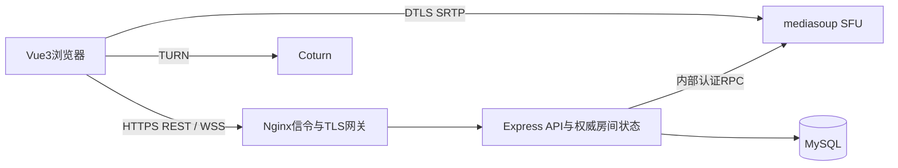
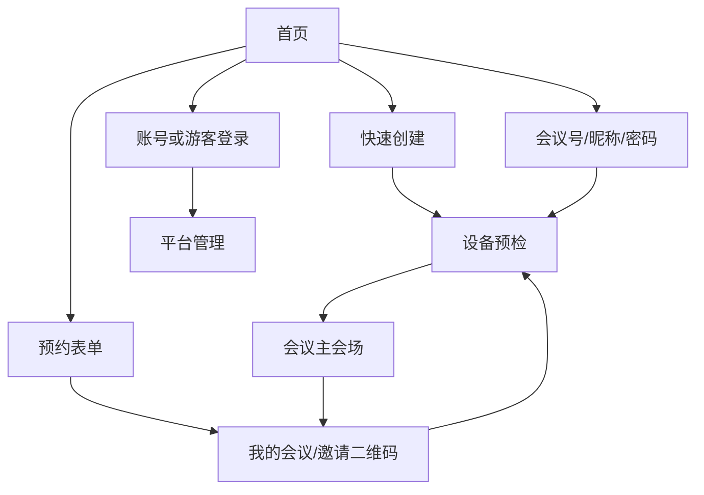

# 实现架构与页面流程

五服务：mysql、api、signaling、sfu、coturn。signaling 是 TLS/WebSocket 网关，业务进程持有 Socket.IO 房间和授权状态，避免两个进程各自维护一份冲突成员表。SFU负责实际媒体路由。开发默认使用SQLite，生产使用MySQL。当前单API权威设计，不支持直接多副本扩容。

页面字段遵循原PRD：预约保存主题、开始时间、时长、容量、密码、默认静音、主持人前入会；等候室隐藏。预检提供相机/麦克风/扬声器选择、音量检测和测试音；会场拆分 VideoCanvas、ParticipantList、ToolBar、ChatPanel。

25人每人发布1Mbps视频+64kbps音频，全订阅情况下SFU出站约25×24×1.064≈638Mbps，协议开销需额外预留。simulcast降层可降低平均流量；按实测活动流数和出口带宽规划，不能从本地测试推断300ms时延达标。
