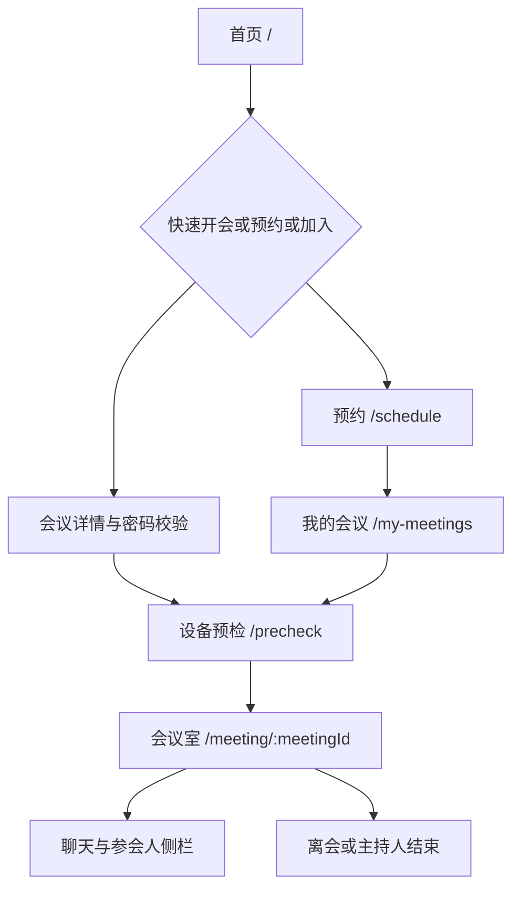

# 页面原型流程图与字段说明

## 页面流程

## 首页字段

| 字段 | 类型 | 规则 | 接口 |
|---|---|---|---|
| meetingId | 文本 | 加入必填，SH-六位数字 | detail、join |
| nickname | 文本 | 1-40字符 | guest-login、join |
| password | 密码 | 按详情显示，6位数字 | join |
| audioOff/videoOff | 布尔 | 本地入会偏好 | precheck/media |

## 预约字段

title 必填最长100；startTime 为 Unix 毫秒且晚于当前时间；duration 默认60、范围1-1440；meetingPassword 可空，非空为6位数字；maxParticipants 默认25；openWaitingRoom 一期固定 false 且不展示；joinBeforeHost 默认 true；defaultMute 默认 true。

## 预检、会议室与聊天

预检提供摄像头预览、麦克风音量、扬声器测试、设备选择、静音和关闭视频。返回时停止 MediaStream，不调用 leave，不占在线人数。

会议室展示会议号、主题、画廊/演讲者、音视频状态、共享状态、昵称、头像、主持人标识、聊天开关和锁定状态。主持人可静音、关视频、移除、全员静音、锁定和开关聊天，不得远程强开设备。

聊天 content 为纯文本，空消息禁止，后端当前上限2000字符；历史消息必须文本转义。我的会议展示 meetingId、title、startTime、duration、maxParticipants、status，并提供进入和取消预约。
